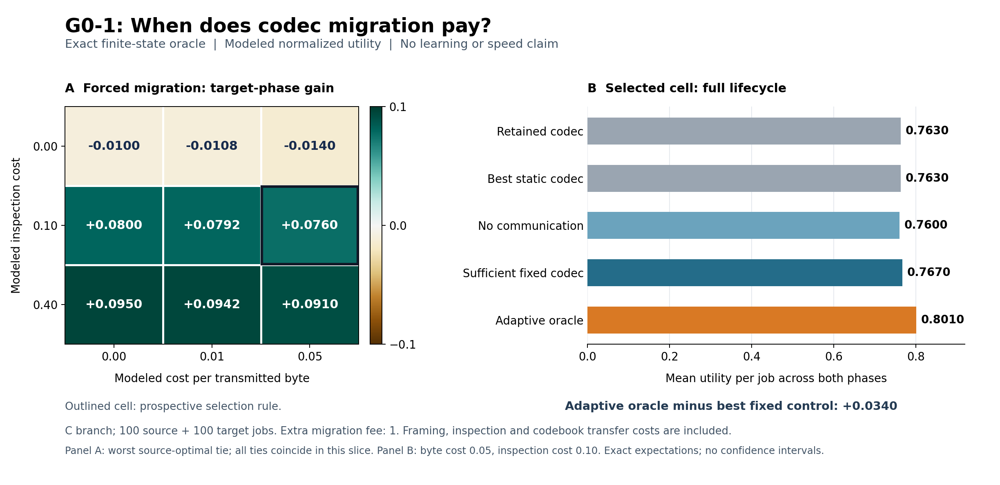

# G0-1: sequential stateful communication diagnostic

**実施日: 2026-11-26 JST / 有限モデルの開発診断を完了。学習実験・G2確証ではない。**

## 1. 結論と根拠

**通信の意味区分を更新する価値が、検査・通信・移行の費用を含めても残る有限モデルの条件を確認した。** 事前に固定した選択規則で採用された条件では、変更前後を通じた平均純効用は更新オラクル **0.801**、固定の十分情報コード **0.767**、最良の1記号静的コード **0.763**、通信なし **0.760** だった。

ただし、オラクルは変更後の環境と最適方策を知っている。**経験から小型モデルが通信を学び直した結果ではない。** 更新の強制が損になる条件も全て保存した。学習・同期時間が実測で回収できるかは未検証である。

- 設定・選択規則: [g01.json](../protocols/g01.json)。結果を計算する前に [c37c867](https://github.com/Unjuno/etal/commit/c37c867cf3479daf2ac7765c25d2182c9540bf07) で公開した。G2の事前登録とは区別する。
- 全243条件: [grid.csv](../results/g01/grid.csv)。浮動小数点への丸めを避け、分数で保存。
- 全コードの評価: [codec_metrics.csv](../results/g01/codec_metrics.csv)。各条件18コード、9個の分岐・検査費用設定。
- 独立レビュー: [G01_REVIEW.md](G01_REVIEW.md)。同一チーム内の別担当による実装レビューであり、外部査読ではない。
- 実行条件・ハッシュ: [runtime.json](../results/g01/runtime.json)、[manifest.json](../results/g01/manifest.json)。

## 2. 何を実装したか

二つの記録 A/B がそれぞれ未作成または作成済みの状態から、両方を一つずつ正しく残す復旧作業を行う。最初の状態は人工的な途中引継ぎであり、それ以前の書込みをモデルが学習したとはしない。

| 要素 | 固定した仕様 |
|---|---|
| 初期世界 | A/B の4状態 × 最初のWRITEの3故障、計12世界を全列挙 |
| 初期頻度 | N/Cは各記録が独立に確率1/2で未作成。FだけA未作成を3/4に変更 |
| 故障 | なし1/2、書込み前の失敗1/4、commit後の応答喪失1/4 |
| 原子的操作 | WRITE、INSPECT、REPAIRを各記録に対して選択、最後にFINALIZE |
| 最大呼出し数 | FINALIZEを含め5回。期限内に明示的に完了しなければ失敗 |
| 再試行 | N/FではAが追記、Bが冪等。CではAが冪等、Bが追記へ交換 |
| 重複 | 個数を2で打ち切る有限モデル。重複を一度起こした損害は修復しても消えない |
| 修復 | 一つの記録を0個へ戻す。完了には別のWRITEが必要 |
| 送信者 | 開始時の正確なローカル受領記録を一回だけ見る。将来の故障は見えない |
| 受信者 | 開始時のメッセージと自分の操作・公開応答の履歴だけを見る |
| 評価器 | 実際の保存状態と損害を読む。モデルの成功宣言には依存しない |

書込み前失敗とcommit後の応答喪失は、共に `TIMEOUT` と表示する。後者では保存状態が既に変わっている。次の操作はその状態から続く。手書きの復旧マクロを一度選択する方式ではない。

SQLite版は有限環境の遷移関数を呼ばず、実際の一時DBファイルに行を作成・削除する。応答喪失はtransactionのcommit後に注入する。単一transactionが都合よく半分だけcommitする故障は使わない。SQLiteの原子性の意味は[公式資料](https://www.sqlite.org/atomiccommit.html)を参照。故障自体はプログラムによる注入であり、実ネットワーク障害や電源断の試験ではない。

**観測の限界:** ローカル受領記録は正確で、開始時のA/Bを完全に識別できる。現実の不完全・古いログから状態を推論する問題は解いていない。APIの分離は呼出規約とテストによるもので、OSによる権限隔離ではない。

## 3. 比較と費用

一作業につき開始時に一回送信する。全方式が同じ2バイトの版番号・長さヘッダを使う。

| 方式 | データフレーム | 初期コード配布 | 更新 |
|---|---:|---:|---|
| 1記号コード | 3バイト | 8バイト | 変更時に8バイトと追加更新費用 |
| 固定十分コード | 4バイト | 12バイト | なし |
| 通信なし | 空payloadの2バイト | 0バイト | なし |

バイト数は実際にシリアライズした長さである。ネットワーク転送時間は測っていない。配布には4観測へのコード表と2バイトの確認応答を含む。版番号が違うメッセージは拒否する。理想的な作業間バリアを仮定し、更新中の錯誤や実際のモデル計算は追加費用パラメータで感度分析する。これは分散学習の完全な実費台帳ではない。

探索する1記号コードは、4種類の受領記録から `a` / `b` への全16写像。固定十分コードは `aa,ab,ba,bb`、通信なしは空文字列。受信側はいずれも有料のINSPECTを使える。方式ごとに都合よく観測操作を制限しない。

全ての旧最適コードの同点解を保存し、その範囲を報告する。最良の静的コードは変更前後を知って一つの写像を選ぶ強い対照であり、受信行動は各期で最適化し直せる。語形の固定と行動の固定を混同しない。

| 費用項目 | 設定値（成功1に正規化した効用） |
|---|---|
| WRITE一回 | 0.02 |
| REPAIR一回 | 0.10 |
| 不可逆損害一作業 | 0.50 |
| INSPECT一回 | 0 / 0.10 / 0.40 |
| フレーム1バイト | 0 / 0.01 / 0.05 |
| 追加更新費用一回 | 0 / 1 / 10 |
| 各期の作業数 | 10 / 100 / 1,000 |

3分岐と上記の可変費用・作業数を組み合わせ、243条件を全て評価した。0.05/バイト等は人工的な価格であり、特定の回線・LLM APIの実測価格ではない。

## 4. 全条件の結果

| 強制更新の変更後純効用差 | 条件数 | 解釈 |
|---|---:|---|
| 全ての旧最適コードで正 | 40 | モデル内で更新費用を回収できる |
| 全てで負 | 177 | 更新を強制すると損になる |
| 全てで厳密に0 | 18 | 差がない |
| 旧最適コードの同点解に依存 | 8 | 一つの符号だけ選んだ結論を避ける |
| 合計 | 243 | 全セル保持 |

更新しない選択を許すオラクルの利益は定義上負にならない。195条件では、どの旧最適コードでも更新の追加利益が0だった。「適応は害を起こさない」という経験的発見ではない。

全期間で三つの強い静的対照を全て上回る条件は12個だった。この比率は指定グリッド上の件数であり、現実のタスクで成功する確率ではない。

Fは頻度のみを変えた対照であって、一般に通信更新の利益が0となる保証はない。Nが無変更対照である。Cで初期分布が同じでも、途中の訪問状態頻度は方策に依存して変わる。

## 5. 事前規則で選ばれた条件

追加更新費用1、各期100作業という候補内で、全ての旧同点解に対する更新利益と全期間の最良固定対照との差が0.02を超え、選んだ最適方策が成功率1・損害0となることを要求した。候補のうちバイト費用、次に検査費用が最小のものを採用した。結果はバイト費用0.05、検査費用0.10だった。学習器の勝敗を見て選んだ条件ではない。

| 比較方式 | 変更後の効用 / 作業 | 変更前後の効用 / 作業 |
|---|---:|---:|
| 旧最適コードを保持、行動は最適化し直す | 0.720 | 0.763 |
| 最良の1記号静的コード | 写像に依存 | 0.763 |
| 通信なし、有料検査あり | 0.760 | 0.760 |
| 固定十分コード | 0.770 | 0.767 |
| 意味区分を更新するオラクル、移行費用込み | **0.796** | **0.801** |

更新の変更後増分は0.076、全期間で最良の固定対照に対する増分は0.034。成功率等は12世界をその確率で重み付けした厳密な期待値であり、12個の学習シードの測定ではない。全列挙なのでこのモデル内のMonte Carlo標準誤差はない。現実環境への誤差がゼロになるわけではない。

### 意味区分はどう変わったか

| 初期状態（A,B） | 変更前の代表コード | 変更後の代表コード |
|---|---|---|
| (0,0) | a | a |
| (0,1) | a | b |
| (1,0) | b | a |
| (1,1) | b | b |

変更前は追記対象Aの有無、変更後は追記対象Bの有無を区別する。単なる `a` と `b` の改名では区分が一致しない。記号を送受信で一括改名した対照では値が変わらないことを検査した。ただし、この区分は最適化で計算したもので、自発的に学習された言語ではない。

### 方策がモデルの構造を利用する点

故障は「最初のWRITE一回だけ」なので、オラクルは冪等な側へ先にWRITEし、そこで故障を消費してから追記側へ進める。例えばCで両方未作成、最初の故障が応答喪失の場合、`WRITE_A → TIMEOUT → WRITE_A → OK → WRITE_B → OK → FINALIZE` となる。Aへの最初のWRITEはcommit済みだが、再試行しても重複しない。

これは環境内で正しい解法である。同時に、複数回発生する未知の障害への一般化を保証しないことを示している。全12初期世界の代表軌跡とSQLiteの注入イベントを [representative_traces.json](../results/g01/representative_traces.json) に保存した。

## 6. 最適性・費用計算の確認

### 変数表

SI単位欄の「1」は無次元を表す。バイトと作業は個数単位でありSI基本単位ではない。

| 記号 | 意味 | SI単位・計数単位 | 定義 | 範囲・前提 | 型 |
|---|---|---|---|---|---|
| H | 一期の作業数 | 1、作業個数 | 前期・後期とも同数 | 10/100/1,000 | 整数スカラー |
| u_s | 前期一作業の効用 | 1 | 成功・損害・ツール・フレームの費用を含む | 配布費用を除く | 実数スカラー |
| u_t | 旧コード保持時の後期効用 | 1 | 行動を最適化し直した値 | 配布・移行を除く | 実数スカラー |
| v_t | 後期最適コードの効用 | 1 | 同じ受信者の最適化規則 | 配布・移行を除く | 実数スカラー |
| D | 初期配布の費用 | 1 | 配布・確認応答のバイト数×バイト費用 | 非負 | 実数スカラー |
| M | 一回の移行費用 | 1 | 配布・確認応答費用＋追加更新費用 | 非負 | 実数スカラー |
| U_keep | 保持時の全期間平均 | 1 | 下式 | 前後H作業 | 実数スカラー |
| U_switch | 強制更新時の全期間平均 | 1 | 下式 | 一回の移行 | 実数スカラー |

\[
U_{\rm keep}=\frac{H u_s+H u_t-D}{2H},\qquad
U_{\rm switch}=\frac{H u_s+H v_t-D-M}{2H}.
\]

任意更新は両者の大きい方を採る。この最大値が保持より低くならないことは定義から従う。負の結果の評価には、最大値を取る前の強制更新を使う。

選択条件では1記号コードの初期配布が8バイトなので、D=0.4、M=0.4+1=1.4。前期と変更後最適コードの効用はいずれも0.81。分子は100×0.81+100×0.81−0.4−1.4=160.2、分母200で0.801となる。固定十分コードは前後0.77、初期12バイトの0.6を引き、153.4/200=0.767。

**単位チェック:** 一作業効用に作業個数を掛けた総効用から、一回の配布・移行効用を引き、総作業個数で割る。秒、byte数、そのままの損害件数を無変換で足し合わせていない。

### 有限最適化が成立する理由

1. 初期世界とその確率を全列挙する。メッセージが届いたとき、そのメッセージを生成し得る世界だけを残し、確率を正規化する。
2. 受信者が次に選べる全7操作を評価する。操作後の世界を公開応答ごとに分ける。各応答を受けた条件付き確率は、その群の確率質量で割って求める。
3. 残り呼出し0では、明示的FINALIZEがなかったので成功報酬0、不可逆損害だけを引く。FINALIZEを選べばその時点の期待成功・損害で終了する。これで再帰の末端を完全に定める。
4. 残り1回なら、全操作の直後の末端値と操作費用を比較すれば最適である。仮に残り回数が一つ少ない全ての到達信念状態で最適値が得られているとする。その値を各公開応答の確率で平均し、直近の操作費用を引けば、その操作を最初に選ぶ全方策の中での最適値となる。
5. 最初の操作は列挙した7種類のいずれかなので、その最大値は、現在の信念状態から実行できる全方策の最適値である。有限回の帰納で最大5呼出しまで成立する。乱択した行動の値は各行動値の加重平均であり、最大値を超えない。
6. 状態と故障残量が将来の遷移を決めるため、観測履歴で条件付けた信念状態はこの有限モデルの意思決定に十分である。実際に採取した隠れ状態を受信者へ渡す必要はない。
7. 1記号の送信写像は全16種類を評価するので、指定した「開始時に1記号を送る決定的な写像」というクラス内での最適値が得られる。可変長の対話、複数回通信、他の観測機構まで含む普遍的最適性は主張しない。

実装は全て有理数で比較する。帰納の前提である遷移・観測仕様が実環境に正しいことは別問題であり、SQLite照合はこの有限仕様の実装整合性を検査する。

### ERROR CHECK

- 33テスト成功（既存10、新規環境14、独立オラクル検査9）。
- 全819個の分岐・有効状態・単一操作と36本の固定復旧軌跡を独立SQLiteと照合。
- 108個の方策・初期世界を、別の評価ループと費用計算でSQLite上で実行しDPの値と一致。
- 本実行では全対象最適コードの同点解と二つの対照について、576作業・2,085呼出しを照合し不一致0。
- 残り2呼出しの手計算例、同点解、版違い、同時改名、費用の一回計上、終了判定を別途検査。
- 独立した再実行でgrid・codec_metrics・summary・代表軌跡のバイト一致を確認する。実行時刻・所要時間は一致を要求しない。

## 7. H / T / D / C / U と進捗判断

| 項目 | この段階での扱い |
|---|---|
| H | 指定有限環境と費用グリッドに、移行後の純利益と最良固定方式に対する全期間の増分が各0.02を超える条件がある |
| T | 243セル・各12世界を全列挙。ソフトウェア欠陥があれば記録して影響範囲を再実行。成功したセルだけで途中停止しない |
| D | 公開済み選択規則で採用セルあり、整数・分数の整合と独立照合が成功したため、**有限G0の選択基準はPASS**。学習のH1–H4の判定ではない |
| C | 固定十分コードが強い、検査が安い、移行が高い、故障が繰返す、受領記録が不正確などで結果が崩れ得る |
| U | 条件付き期待値の列挙誤差は0。有理数計算に丸め誤差はない。コード誤り・仮定誤差・実費への換算誤差は別で、合成不確かさや包含係数を根拠なく数値化しない |

**Q1/Q2:** 有限診断の範囲で完了。**Q3:** 観測APIと対照の検査は進んだが、学習時の重み・勾配・共有メモリの隔離は未検証。**G1以降:** 未実施。次は新しい開発シードで基本技能と通信の安定学習を確認する。G0の良好な結果を理由にG1を飛ばさない。

## 8. 応用・転用と未解決の問い

| 関連分野 | 今回の接続 | 次に必要な検証 |
|---|---|---|
| 言語学・創発通信 | 語形の改名と、伝える意味区分の変更を分ける | 経験から区分が変わること、相互理解と保持 |
| 分散システム | 冪等性、応答喪失、版付き通信、移行費用 | 複数障害、不完全ログ、現実の同期・待ち時間 |
| 強化学習・意思決定 | 同じ情報量でも帰結により必要な区別が変わる | AA対FA、同経験数と同計算費用、独立シード |
| 情報理論 | 圧縮と十分情報を送る費用の比較 | ノイズ、可変長、フレーム込みの符号効率 |

**次に考える問い:** 小型モデルは、故障の性質を最初から知らなくても、試行錯誤と規約変更に払った費用を0.034の理想的な余裕の中で回収できるか。

文字IDを使うこと自体の優位、絵文字の悪影響、緊急性による短縮、学習チャンクによる計算短縮は今回の試験では扱っていない。
